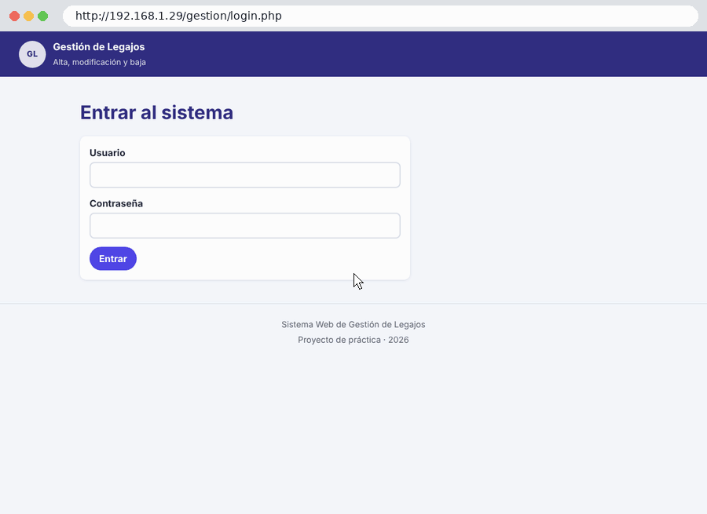
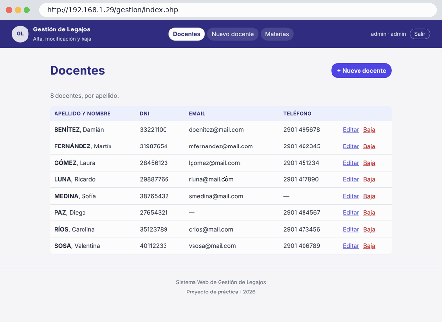
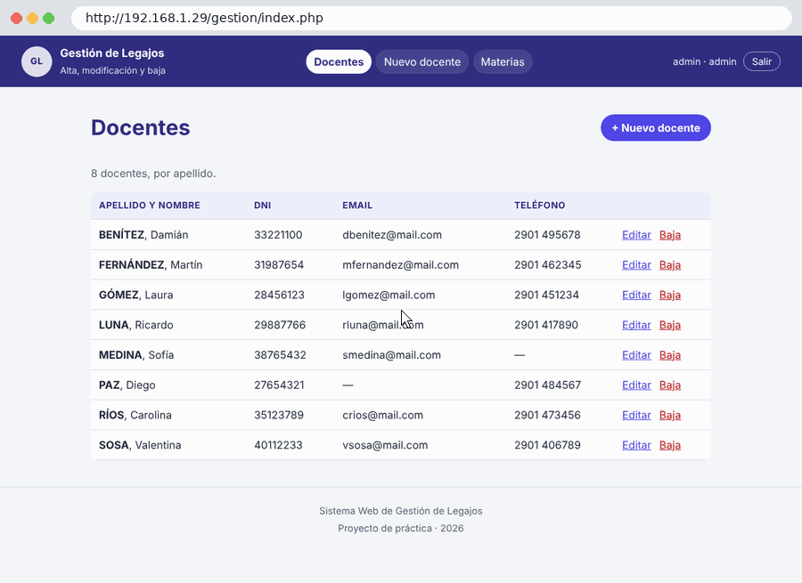
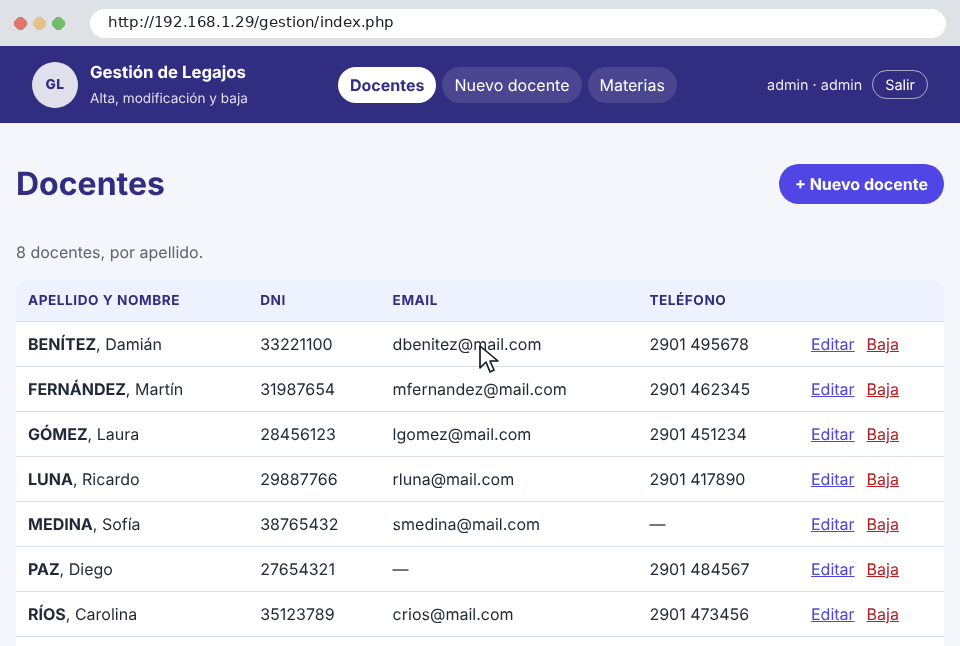
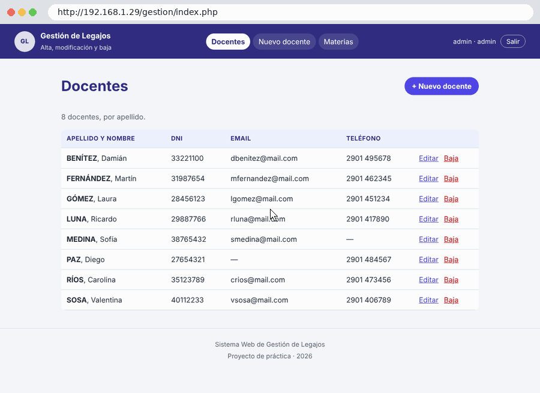
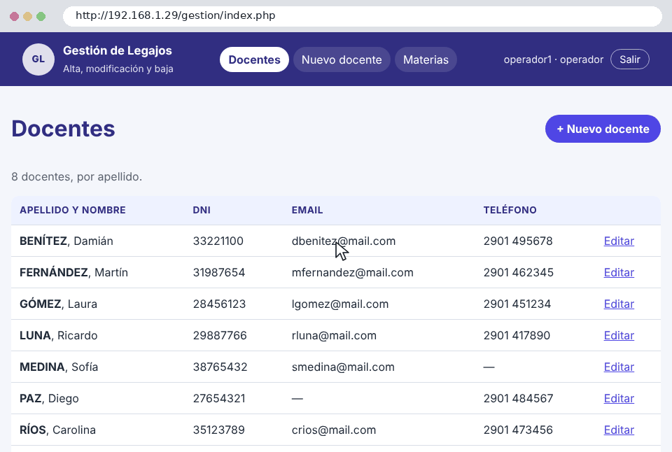

# Gestión de Legajos

<!-- TECNOLOGÍAS -->


## Descripción

Sistema web de gestión institucional que simula la administración de legajos docentes de un establecimiento educativo. Permite gestionar información personal, títulos académicos y las materias que dicta cada docente.

Desarrollado con **PHP** y **MySQL**, sobre una arquitectura **LAMP** (Linux, Apache, MySQL y PHP).

Incluye un sistema de **autenticación con roles de usuario**, operaciones **ABM de docentes** (alta, baja y modificación), consulta de docentes por materia y exportación de información en formato **CSV**, compatible con Microsoft Excel.

> Proyecto de práctica: todos los datos son ficticios.

## Qué hace

- **Login** con usuario y contraseña. Las contraseñas se guardan con `password_hash` (bcrypt) y se comprueban con `password_verify`. Si el usuario no existe o la contraseña está mal, el mensaje es el mismo.
- **Dos roles**: el operador consulta, carga y modifica; el administrador además da de baja. Sin login, cualquier página manda al formulario de ingreso.
- **Token CSRF** en todos los formularios POST: un pedido armado fuera del sistema (con `curl` o desde otra página) se rechaza con 403.
- **Listado** de docentes ordenado por apellido, con los campos vacíos marcados con una raya.
- **Alta** con validación del lado del servidor: DNI de 7 u 8 números (acepta puntos), apellido y nombre obligatorios, email válido si se carga. Si hay errores, el formulario vuelve con lo escrito y el mensaje debajo de cada campo.
- **Modificación** del docente elegido (`editar.php?id=…`), con el formulario cargado con los datos actuales.
- **Baja** en dos pasos, solo para el administrador: el enlace muestra una confirmación y el borrado se hace solo con un formulario POST. Un docente que tiene materias cargadas no se puede dar de baja.
- **DNI repetido**: lo frena el índice `UNIQUE` de la base y se muestra como un mensaje en el campo DNI, en el alta y en la modificación.
- **Docentes por materia**: qué docentes dan cada materia, con filtro por materia y orden por apellido o por materia. El filtro viaja en la URL (`materias.php?materia=Redes+I&orden=apellido`).
- **Exportar a CSV** el listado filtrado, listo para abrir en Excel con las tildes bien y una columna por dato.

## Demo

**Login: contraseña equivocada y entrada al sistema**



**Listado de docentes**



**Alta, con validación y DNI repetido**



**Modificación**



**Baja con confirmación, y un docente con materias que no se puede borrar**



**El operador no ve la baja, y si escribe la dirección a mano recibe un 403**



**Docentes por materia, con filtro y orden**


## Cómo está hecho

| Tema | Cómo se resuelve |
|---|---|
| Conexión | **PDO** con DSN `mysql:host=localhost;dbname=gestion;charset=utf8mb4`, errores como excepciones (`ERRMODE_EXCEPTION`), filas como arrays asociativos y consultas preparadas nativas de MySQL |
| Contraseña de la base | En `config.php`, que **no está en el repositorio** (`.gitignore`). En el repo va `config.ejemplo.php` como modelo |
| Usuario de la base | `app_gestion`, con permisos mínimos (`SELECT`, `INSERT`, `UPDATE`, `DELETE`): la aplicación nunca se conecta como root |
| Contraseñas | `password_hash` (bcrypt, con sal al azar) al guardar y `password_verify` al entrar: en la base nunca está la contraseña. Los usuarios se crean desde la terminal del servidor con `crear_usuario.php`, que pide la contraseña sin mostrarla |
| Sesiones | Cookie `PHPSESSID` con `HttpOnly` (JavaScript no la lee) y `SameSite=Lax`, modo estricto y `session_regenerate_id(true)` al entrar. Salir vacía la sesión, vence la cookie y borra el archivo del servidor |
| Páginas protegidas | `exigir_login()` al principio de cada página (302 al login) y `exigir_admin()` en la baja (403 para el operador) |
| CSRF | Un token de 32 bytes al azar por sesión, oculto en cada formulario POST y comparado con `hash_equals`; sin token o con otro, 403 |
| Inyección SQL | Todo dato que viene de afuera va con **consultas preparadas** (`prepare` + `execute` con marcadores). Lo que no puede ir en un marcador, como el `ORDER BY`, sale de una **lista blanca** |
| XSS | Todo lo que se muestra pasa por `e()`, que usa `htmlspecialchars` |
| Errores | `try/catch`: el detalle técnico va al `error.log` de Apache con `error_log()`; al usuario, un mensaje claro y un código 500 |
| Después de guardar | Patrón **Post/Redirect/Get**: `header('Location: …')` + `exit`, así un F5 no repite el alta |
| GET y POST | GET solo muestra (`editar.php?id=3`, `baja.php?id=7`, el filtro de materias); los cambios se hacen siempre por POST |
| CSV | `fputcsv` sobre `php://output`, con BOM de UTF-8 y punto y coma como separador (lo que espera Excel en español). Un texto que empieza con `=`, `+`, `-` o `@` lleva un apóstrofo adelante, para que Excel no lo tome como fórmula |
| Reglas de la base | `UNIQUE` en el DNI (error 1062) y clave foránea con `ON DELETE RESTRICT` en la tabla `inscripciones`, que une docentes y materias (error 1451): PHP las traduce a mensajes |

El código tiene comentarios para facilitar la lectura de cada sección.

## Estructura

```
gestion-legajos-php/
├── index.php              listado de docentes
├── alta.php               alta (INSERT)
├── editar.php             modificación (UPDATE … WHERE id)
├── baja.php               baja con confirmación (DELETE por POST), solo admin
├── login.php              ingreso: password_verify y la sesión
├── logout.php             salir (POST con token)
├── materias.php           docentes por materia, con filtro y orden
├── exportar.php           el mismo listado en CSV
├── crear_usuario.php      crea usuarios desde la terminal, con password_hash
├── conexion.php           conectar(): la conexión PDO
├── funciones.php          e(), validar_docente(), exigir_login(), token_csrf()…
├── config.ejemplo.php     modelo de configuración (copiar como config.php)
├── includes/
│   ├── header.php         <head>, marca, menú y botón Salir
│   ├── footer.php         pie
│   └── form_docente.php   formulario compartido por el alta y la modificación
├── css/styles.css         estilos, mobile first
├── database/gestion.sql   esquema de la base y datos de prueba
└── docs/demo/             GIF de la demo
```

## Instalación en un servidor LAMP (Ubuntu)

Requisitos: Apache 2.4, PHP 8.1 o superior con `pdo_mysql` (paquete `php-mysql`) y MySQL 8.

1. Copiar el proyecto en la carpeta web (por ejemplo, `/var/www/html/gestion`) y darle el grupo de Apache:
   ```bash
   sudo chown -R $USER:www-data /var/www/html/gestion
   ```
2. Crear la base con los datos de prueba (si ya existe una base `gestion`, la borra):
   ```bash
   sudo mysql < database/gestion.sql
   ```
3. Crear el usuario de la aplicación, en `sudo mysql`:
   ```sql
   CREATE USER 'app_gestion'@'localhost' IDENTIFIED BY 'una-contraseña-segura';
   GRANT SELECT, INSERT, UPDATE, DELETE ON gestion.* TO 'app_gestion'@'localhost';
   ```
4. Crear la configuración real, poner la contraseña y dejarla solo para Apache:
   ```bash
   cp config.ejemplo.php config.php
   chmod 640 config.php
   ```
5. Crear el primer usuario desde la terminal del servidor, en la carpeta del sistema. Pide la contraseña dos veces y no la muestra (12 caracteres o más):
   ```bash
   php crear_usuario.php admin admin
   php crear_usuario.php operador1 operador
   ```
6. Sacar `database/` de la carpeta web (Apache la mostraría como texto) y abrir `http://IP-DEL-SERVIDOR/gestion/login.php`.

## Instalación en XAMPP (Windows)

1. Copiar la carpeta en `C:\xampp\htdocs\gestion` y arrancar Apache y MySQL desde el panel de XAMPP.
2. En phpMyAdmin (`http://localhost/phpmyadmin`), pestaña **Importar**, cargar `database/gestion.sql`.
3. Copiar `config.ejemplo.php` como `config.php` y completar el usuario y la contraseña. XAMPP trae `root` sin contraseña: sirve para practicar en la propia PC, nunca en un servidor.
4. Crear el primer usuario: en el panel de XAMPP, botón **Shell**, entrar a la carpeta y correr `php crear_usuario.php admin admin`. En Windows la contraseña se ve mientras se escribe.
5. Abrir `http://localhost/gestion/login.php`.

## Probado en el servidor

Salidas reales, en Ubuntu Server 26.04 con Apache 2.4.66, PHP 8.5.4 y MySQL 8.4.13:

```console
$ curl -s -o /dev/null -w "%{http_code} %{size_download} bytes\n" http://localhost/gestion/config.php
200 0 bytes

$ curl -s -o /dev/null -w "%{http_code}\n" "http://localhost/gestion/editar.php?id=99"
404
```

`config.php` pedido desde el navegador no muestra nada: PHP lo ejecuta y devuelve el array a quien hace `require`. Si MySQL no responde, el usuario ve un aviso y en el `error.log` queda el detalle:

```
[php:notice] … Error de conexi\xc3\xb3n a MySQL: SQLSTATE[HY000] [2002] No such file or directory
```

(Apache anota las letras con tilde como sus bytes en UTF-8: `\xc3\xb3` es la **ó**.)

Sin sesión, cada página manda al login, y `crear_usuario.php` no responde desde el navegador:

```console
$ curl -s -o /dev/null -w "%{http_code} -> %{redirect_url}\n" -X POST "http://localhost/gestion/baja.php?id=7"
302 -> http://localhost/gestion/login.php

$ curl -s -o /dev/null -w "%{http_code}\n" http://localhost/gestion/crear_usuario.php
404
```

Con una sesión de administrador abierta con `curl` (`-c` guarda la cookie y `-b` la manda), la baja sin el token del formulario no pasa:

```console
$ curl -s -b c.txt -o /dev/null -w "baja sin token: %{http_code}\n" -X POST "http://localhost/gestion/baja.php?id=13"
baja sin token: 403

$ curl -s -b c.txt -o /dev/null -w "baja con token inventado: %{http_code}\n" -d "csrf=1234" "http://localhost/gestion/baja.php?id=13"
baja con token inventado: 403
```

La exportación de Redes I (`ef bb bf` es el BOM):

```console
$ curl -s -b c.txt -D - -o redes.csv "http://localhost/gestion/exportar.php?materia=Redes+I" | grep -i content-
Content-Disposition: attachment; filename="docentes-por-materia-2026-11-25.csv"
Content-Length: 289
Content-Type: text/csv; charset=UTF-8

$ head -c 3 redes.csv | od -An -tx1
 ef bb bf

$ cat redes.csv
Apellido;Nombre;DNI;Email;Materia
Fernández;Martín;31987654;mfernandez@mail.com;"Redes I"
Gómez;Laura;28456123;lgomez@mail.com;"Redes I"
Luna;Ricardo;29887766;rluna@mail.com;"Redes I"
Medina;Sofía;38765432;smedina@mail.com;"Redes I"
Ríos;Carolina;35123789;crios@mail.com;"Redes I"
```

## Licencia

[MIT](https://github.com/Prof-NkoCussi/infraestructura-redes-lamp/blob/main/LICENSE) © Prof. Nicolás A. Cussi\
*Full Stack Developer • Data Science • AI*
