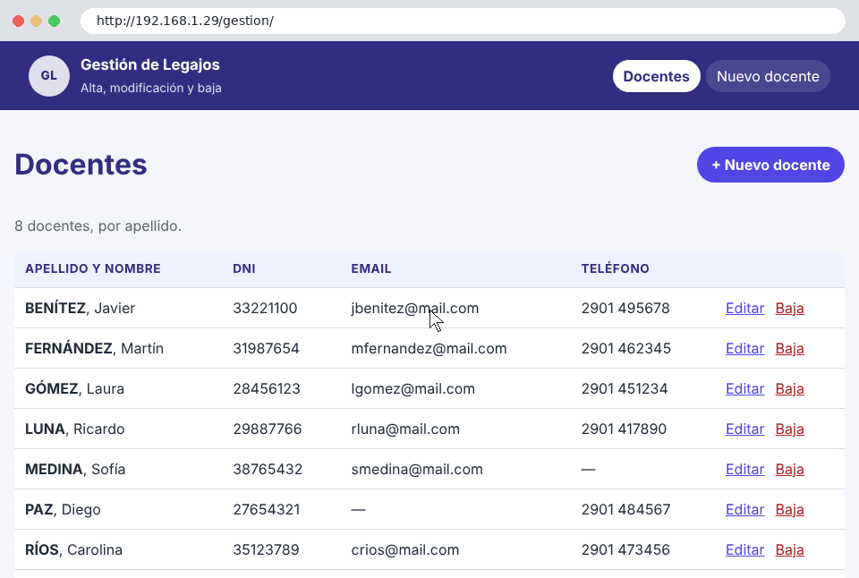
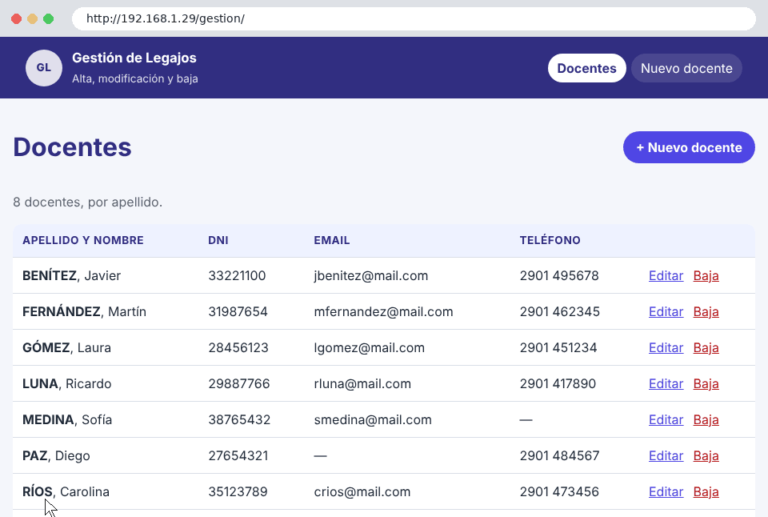

# Gestión de Legajos

Sistema web para administrar los legajos de docentes —datos personales, títulos e inscripciones— hecho con **PHP** y **MySQL** sobre un servidor **LAMP** (Linux, Apache, MySQL, PHP). Esta versión tiene el **ABM de docentes**: listado, alta, modificación y baja.

> Proyecto de práctica: todos los datos son ficticios.

## Qué hace

- **Listado** de docentes ordenado por apellido, con los campos vacíos marcados con una raya.
- **Alta** con validación del lado del servidor: DNI de 7 u 8 números (acepta puntos), apellido y nombre obligatorios, email válido si se carga. Si hay errores, el formulario vuelve con lo escrito y el mensaje debajo de cada campo.
- **Modificación** del docente elegido (`editar.php?id=…`), con el formulario cargado con los datos actuales.
- **Baja** en dos pasos: el enlace muestra una confirmación y el borrado se hace solo con un formulario POST. Un docente con inscripciones no se puede dar de baja.
- **DNI repetido**: lo frena el índice `UNIQUE` de la base y se muestra como un mensaje en el campo DNI, en el alta y en la modificación.

## Demo

**Listado de docentes**



**Alta, con validación y DNI repetido**



**Modificación**


**Baja con confirmación, y un docente con inscripciones que no se puede borrar**


## Cómo está hecho

| Tema | Cómo se resuelve |
|---|---|
| Conexión | **PDO** con DSN `mysql:host=localhost;dbname=gestion;charset=utf8mb4`, errores como excepciones (`ERRMODE_EXCEPTION`), filas como arrays asociativos y consultas preparadas nativas de MySQL |
| Contraseña de la base | En `config.php`, que **no está en el repositorio** (`.gitignore`). En el repo va `config.ejemplo.php` como modelo |
| Usuario de la base | `app_gestion`, con permisos mínimos (`SELECT`, `INSERT`, `UPDATE`, `DELETE`): la aplicación nunca se conecta como root |
| Inyección SQL | Todo dato que viene de afuera va con **consultas preparadas** (`prepare` + `execute` con marcadores) |
| XSS | Todo lo que se muestra pasa por `e()`, que usa `htmlspecialchars` |
| Errores | `try/catch`: el detalle técnico va al `error.log` de Apache con `error_log()`; al usuario, un mensaje claro y un código 500 |
| Después de guardar | Patrón **Post/Redirect/Get**: `header('Location: …')` + `exit`, así un F5 no repite el alta |
| GET y POST | GET solo muestra (`editar.php?id=3`, `baja.php?id=7`); los cambios se hacen siempre por POST |
| Reglas de la base | `UNIQUE` en el DNI (error 1062) y clave foránea con `ON DELETE RESTRICT` en las inscripciones (error 1451): PHP las traduce a mensajes |

El código tiene comentarios para facilitar la lectura de cada sección.

## Estructura

```
gestion-legajos-php/
├── index.php              listado de docentes
├── alta.php               alta (INSERT)
├── editar.php             modificación (UPDATE … WHERE id)
├── baja.php               baja con confirmación (DELETE por POST)
├── conexion.php           conectar(): la conexión PDO
├── funciones.php          e(), limpiar(), validar_docente(), redirigir()…
├── config.ejemplo.php     modelo de configuración (copiar como config.php)
├── includes/
│   ├── header.php         <head>, marca y menú
│   ├── footer.php         pie
│   └── form_docente.php   formulario compartido por el alta y la modificación
├── css/styles.css         estilos, mobile first
├── database/gestion.sql   esquema de la base y datos de prueba
└── docs/demo/             GIF de la demo
```

## Instalación en un servidor LAMP (Ubuntu)

Requisitos: Apache 2.4, PHP 8.1 o superior con `pdo_mysql` (paquete `php-mysql`) y MySQL 8.

1. Copiar el proyecto en la carpeta web (por ejemplo, `/var/www/html/gestion`) y darle el grupo de Apache:
   ```bash
   sudo chown -R $USER:www-data /var/www/html/gestion
   ```
2. Crear la base con los datos de prueba (si ya existe una base `gestion`, la borra):
   ```bash
   sudo mysql < database/gestion.sql
   ```
3. Crear el usuario de la aplicación, en `sudo mysql`:
   ```sql
   CREATE USER 'app_gestion'@'localhost' IDENTIFIED BY 'una-contraseña-segura';
   GRANT SELECT, INSERT, UPDATE, DELETE ON gestion.* TO 'app_gestion'@'localhost';
   ```
4. Crear la configuración real, poner la contraseña y dejarla solo para Apache:
   ```bash
   cp config.ejemplo.php config.php
   chmod 640 config.php
   ```
5. Sacar `database/` de la carpeta web (Apache la mostraría como texto) y abrir `http://IP-DEL-SERVIDOR/gestion/`.

## Instalación en XAMPP (Windows)

1. Copiar la carpeta en `C:\xampp\htdocs\gestion` y arrancar Apache y MySQL desde el panel de XAMPP.
2. En phpMyAdmin (`http://localhost/phpmyadmin`), pestaña **Importar**, cargar `database/gestion.sql`.
3. Copiar `config.ejemplo.php` como `config.php` y completar el usuario y la contraseña. XAMPP trae `root` sin contraseña: sirve para practicar en la propia PC, nunca en un servidor.
4. Abrir `http://localhost/gestion/`.

## Probado en el servidor

Salidas reales, en Ubuntu Server 26.04 con Apache 2.4.66, PHP 8.5.4 y MySQL 8.4.13:

```console
$ curl -s -o /dev/null -w "%{http_code} %{size_download} bytes\n" http://localhost/gestion/config.php
200 0 bytes

$ curl -s -o /dev/null -w "%{http_code}\n" "http://localhost/gestion/editar.php?id=99"
404
```

`config.php` pedido desde el navegador no muestra nada: PHP lo ejecuta y devuelve el array a quien hace `require`. Si MySQL no responde, el usuario ve un aviso y en el `error.log` queda el detalle:

```
[php:notice] … Error de conexi\xc3\xb3n a MySQL: SQLSTATE[HY000] [2002] No such file or directory
```

(Apache anota las letras con tilde como sus bytes en UTF-8: `\xc3\xb3` es la **ó**.)

## Próximas funciones

- Login con sesiones y contraseñas con `password_hash`
- Orden de mérito de los inscriptos, con filtro por cargo o materia
- Exportación del listado a CSV

## Licencia

[MIT](https://github.com/Prof-NkoCussi/infraestructura-redes-lamp/blob/main/LICENSE) © Prof. Nicolás A. Cussi\
*Full Stack Developer • Data Science • AI*
